# KS-AIcodeEditor 🚀

### Agentic AI & Generative AI Powered Code Editor

**Code Smarter. Build Faster. Develop with AI.**

KS-AIcodeEditor is an AI-powered code editor inspired by modern development environments. It combines a developer-friendly coding experience with Generative AI capabilities to help developers generate code using natural-language instructions.

The application allows users to describe their coding requirements, receive AI-generated code, and save generated files directly into their project workspace.

The project explores the integration of **Generative AI, Large Language Models (LLMs), Agentic AI concepts, AI-powered workflows, backend automation, and microservices architecture** to improve developer productivity.

---

## ✨ Key Features

- **AI Code Generation:** Generate code using natural-language prompts.
- **Generative AI Integration:** Use LLMs to understand user requirements and generate code.
- **AI-Assisted Development:** Get AI assistance for coding tasks.
- **Code Editor:** Integrated code-editing experience.
- **Automatic File Saving:** Save AI-generated code directly into project folders.
- **Project Management:** Organize generated files and development projects.
- **Microservices Architecture:** Separate backend responsibilities into independent services.
- **API Gateway:** Centralized API communication using Express and `express-http-proxy`.
- **Authentication:** User authentication and protected application functionality.
- **Terminal Integration:** Backend terminal service integration.
- **Payment System:** Payment integration for premium functionality.

---

## 🧠 AI Concepts & Engineering

KS-AIcodeEditor explores how Generative AI and Agentic AI concepts can be applied to modern software development workflows.

### 1. Generative AI (GenAI)

Generative AI enables applications to create new content based on user instructions and learned patterns.

In KS-AIcodeEditor, Generative AI is used for AI-powered code generation.

**Key Concepts:**

- Large Language Models (LLMs)
- Prompt Engineering
- Natural Language Understanding
- Context-Aware Code Generation
- AI API Integration
- Structured AI Responses
- Code Generation Workflows
- LLM-Based Application Development

**Workflow:**

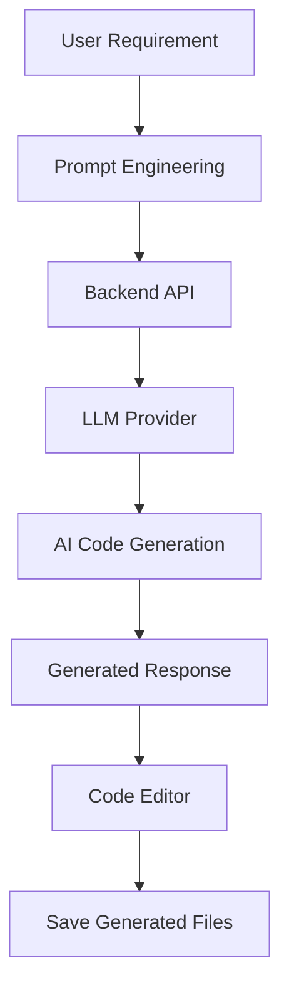

### 2. Agentic AI

Agentic AI refers to AI systems that can work toward a goal through reasoning, planning, tool usage, and multi-step execution.

KS-AIcodeEditor provides a foundation for exploring Agentic AI workflows in software development.

**Important Agentic AI Concepts:**

- AI Agents and Agent Architecture
- Goal-Oriented Task Execution
- Planning and Reasoning
- Tool Calling and Function Calling
- Multi-Step AI Workflows
- Context Management
- Agent Orchestration
- Human-in-the-Loop Workflows
- Error Handling and Execution Control

**Conceptual Agentic AI Workflow:**

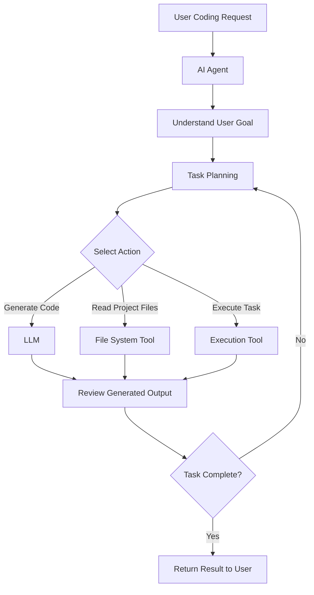

### 3. Large Language Models (LLMs)

LLMs are AI models trained on large amounts of text and code data to understand and generate human-like responses.

KS-AIcodeEditor uses an AI model integration to process coding instructions and generate code.

**Important Concepts:**

- Tokens and Tokenization
- Context Windows
- System Prompts and User Prompts
- Temperature and Model Parameters
- Input and Output Tokens
- Model API Integration
- Response Processing
- LLM Limitations and Hallucinations

### 4. Retrieval-Augmented Generation (RAG)

RAG combines information retrieval with Generative AI. It provides an LLM with relevant external information before generating a response.

For a code editor, RAG can help an AI system understand existing project files, documentation, and code snippets.

**RAG Concepts:**

- Document and Code Ingestion
- Text Chunking
- Embedding Generation
- Vector Databases
- Semantic Search
- Similarity Search
- Context Retrieval
- Augmented Prompt Construction

**Conceptual RAG Workflow:**

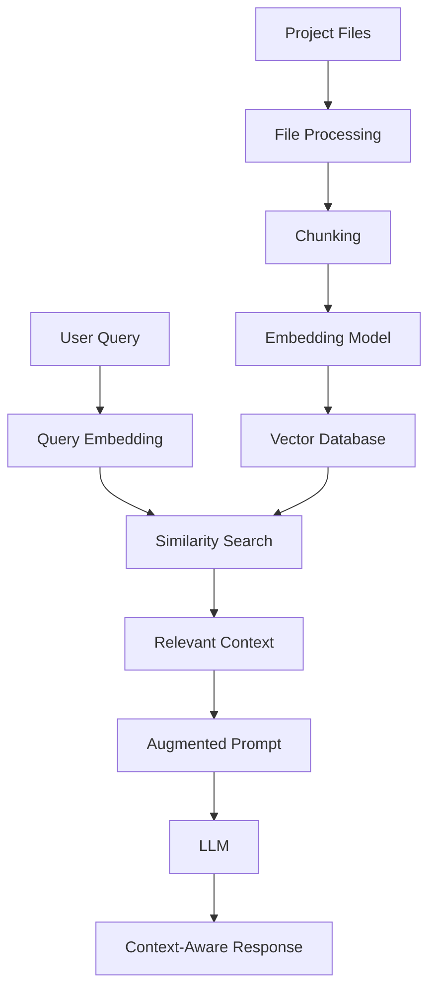

### 5. AI Tool Calling & Function Calling

Tool calling allows an AI model or agent to request external functions to perform specific tasks.

Possible applications in an AI code editor include:

- Reading project files.
- Creating new files.
- Updating existing code.
- Searching project documentation.
- Running development commands.
- Analyzing code errors.

Tool execution must be validated and controlled by the backend before performing operations.

### 6. AI Workflow Orchestration

AI workflow orchestration manages multiple steps involved in completing a task.

Important concepts include:

- Sequential AI Workflows
- Conditional Execution
- Task Planning
- Agent State Management
- Tool Selection
- Retry and Error Handling
- Human Approval
- Workflow Monitoring

These concepts provide a foundation for building more advanced Agentic AI development assistants.

---

## 🛠️ Tech Stack

| Category | Technologies |
|---|---|
| Frontend | React.js, JavaScript, Vite |
| Code Editor | Monaco Editor |
| Backend | Node.js, Express.js |
| Architecture | Microservices |
| API Gateway | Express.js, express-http-proxy |
| Database | MongoDB |
| Authentication | JWT |
| AI Integration | AI APIs / LLM Provider |
| AI Concepts | GenAI, Agentic AI, Prompt Engineering |
| Payment | Payment Gateway |
| Deployment | Render |
| Development Tools | Git, GitHub, VS Code |

---

## 🏗️ System Architecture

KS-AIcodeEditor follows a service-based backend architecture that separates application responsibilities.

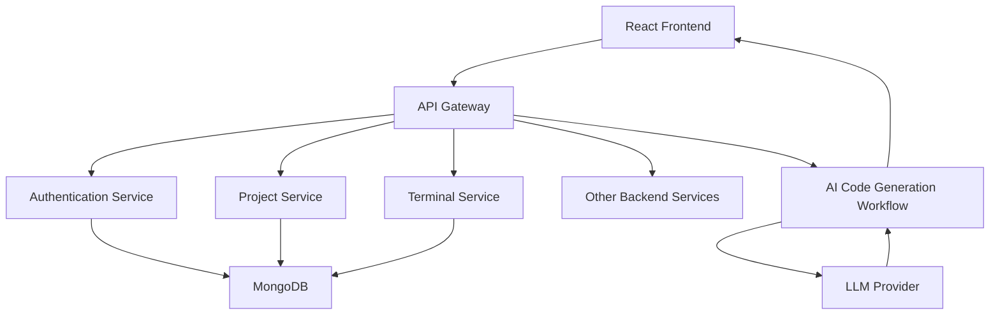

### Architecture Components

| Component | Responsibility |
|---|---|
| Frontend | User interface and code editor |
| API Gateway | Centralized API routing |
| Authentication Service | User authentication |
| Project Service | Project and file management |
| Terminal Service | Terminal-related operations |
| AI Integration | AI-powered code generation |
| Database | Application data storage |

---

## ⚙️ How KS-AIcodeEditor Works

1. The user opens the application.
2. The user enters a coding requirement using a natural-language prompt.
3. The frontend sends the request to the backend through the API Gateway.
4. The backend communicates with the configured AI model.
5. The AI generates the requested code.
6. The generated response is returned to the frontend.
7. The user can save the generated code into the selected project folder.

---

## 📸 Project Screenshots

Screenshots of the application interface and its capabilities.

### Home Screen

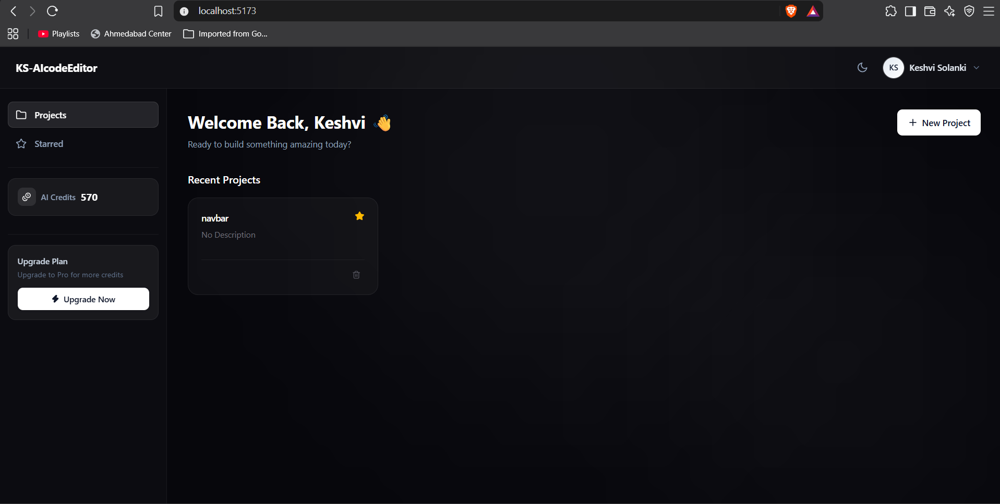


### Payment System

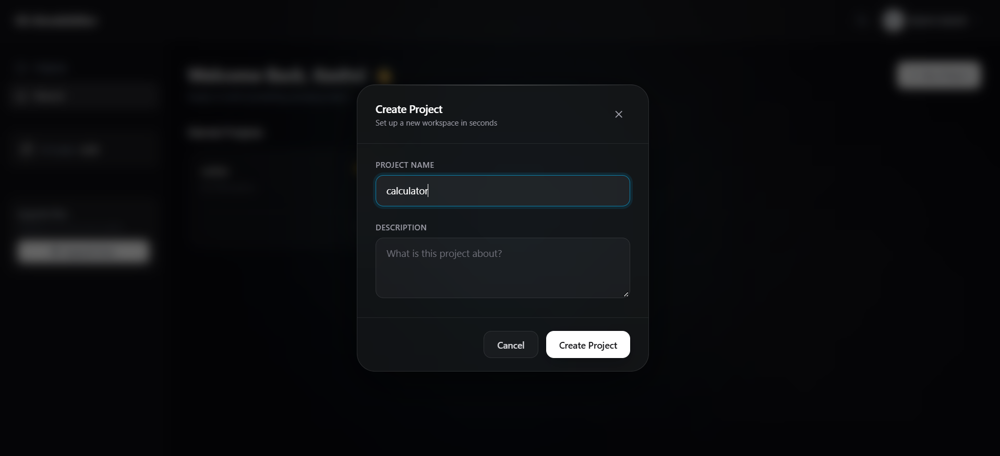


### AI Code Editor

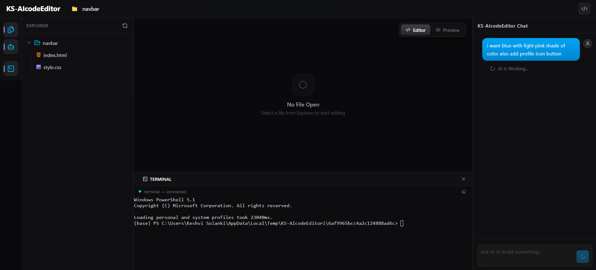

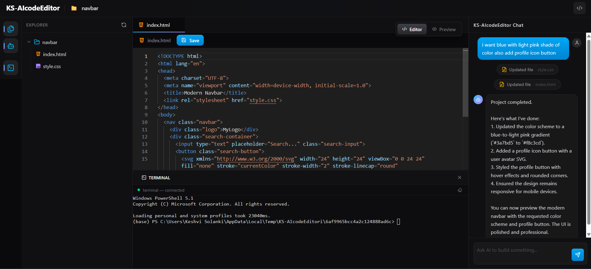


### AI Code Generation

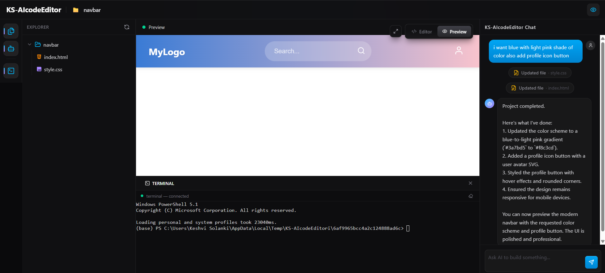


### Star a liked project

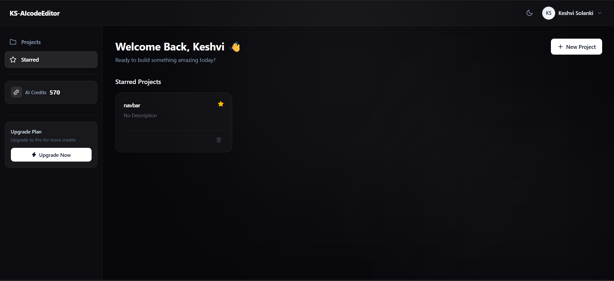


### Payment System

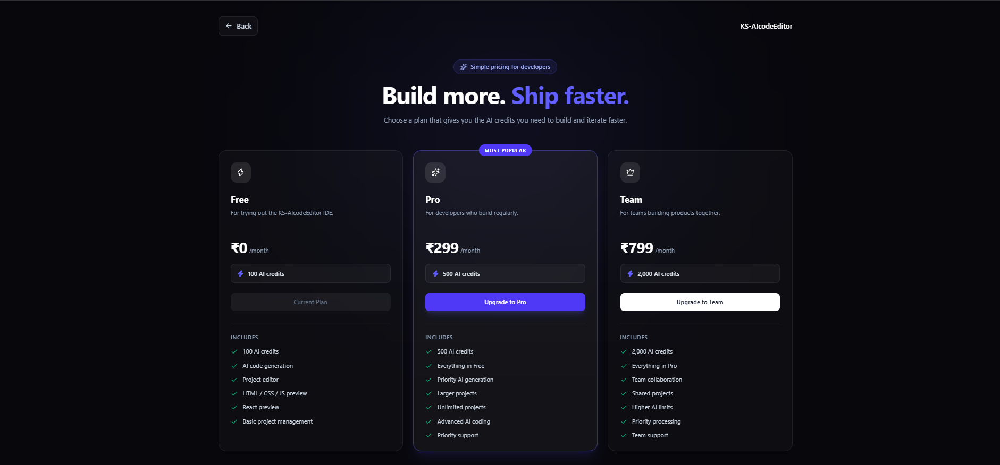


### temes 

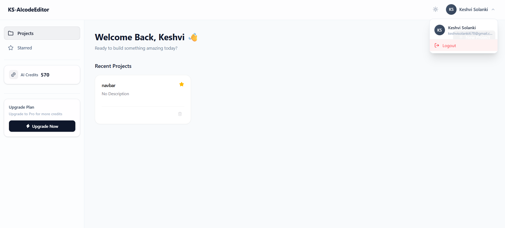

---

## ☁️ Deployment on Render

The project has been configured for deployment using Render, with separate services for the frontend and backend microservices.

### Backend Services

| Service | Deployment URL |
|---|---|
| Gateway | https://ks-aicodeeditor-gateway.onrender.com |
| Auth Service | https://ks-aicodeeditor-auth.onrender.com |
| Project Service | https://ks-aicodeeditor-project.onrender.com |
| Terminal Service | https://ks-aicodeeditor-terminal.onrender.com |

### Deployment Challenges & Troubleshooting

During deployment, I encountered several challenges while configuring the frontend and backend microservices on Render.

#### 1. Frontend Build Error — ENOENT

```text
npm error code ENOENT
npm error syscall open
npm error path /opt/render/project/src/package.json
npm error enoent Could not read package.json
```

**Cause:** Render could not locate the frontend `package.json` because the frontend application is inside a separate directory.

**Required configuration:**
- Root Directory: `frontend`
- Build Command: `npm install && npm run build`
- Publish Directory: `dist`

#### 2. Redis Connection Error

```text
ioredis ECONNREFUSED
```

**Cause:** The deployed service could not establish a connection to the configured Redis server.

#### 3. Gateway Error — 502 Bad Gateway

```text
POST /api/auth/login
502 Bad Gateway
```

**Cause:** The Gateway could not successfully complete the request to the authentication service.

#### 4. Authentication Error — 401 Unauthorized

```text
GET /api/project
401 Unauthorized

GET /api/me
401 Unauthorized
```

**Cause:** Authentication or session handling was not working correctly in the deployed environment.

### Current Deployment Status

Deployment and integration issues are still being investigated.

Areas requiring attention include:

- Redis connectivity between deployed services.
- Gateway-to-microservice communication.
- Authentication and session management.
- Frontend environment variable configuration.
- Production environment configuration.

Documenting these challenges is part of understanding real-world cloud deployment, backend debugging, and microservices integration.

---

## 📁 Project Structure

```text
KS-AIcodeEditor/
│
├── frontend/
│   ├── src/
│   │   ├── components/
│   │   ├── pages/
│   │   └── ...
│   └── package.json
│
├── backend/
│   ├── gateway/
│   ├── services/
│   └── package.json
│
├── screenshots/
│   ├── home.png
│   ├── editor.png
│   ├── ai-code-generation.png
│   ├── login-page.png
│   └── payment-system.png
│
├── .gitignore
└── README.md
```

---

## 🚀 Installation & Setup

### 1. Clone the Repository

```bash
git clone https://github.com/keshviSolanki/KS-AIcodeEditor.git
```

### 2. Navigate to the Project

```bash
cd KS-AIcodeEditor
```

### 3. Install Frontend Dependencies

```bash
cd frontend
npm install
```

### 4. Install Backend Dependencies

```bash
cd ../backend
npm install
```

### 5. Configure Environment Variables

Create the required `.env` files in the frontend and backend service directories.

Example backend configuration:

```env
PORT=8000
MONGODB_URI=your_mongodb_connection_string
JWT_SECRET=your_jwt_secret
AI_API_KEY=your_ai_api_key
```

Use the actual environment variable names required by your source code.

### 6. Start the Application

Start the backend services using their respective development scripts.

Start the frontend in a separate terminal:

```bash
cd frontend
npm run dev
```

---

## 🔐 Security

- Store API keys and credentials in environment variables.
- Never expose private AI API keys in frontend code.
- Protect authenticated routes.
- Validate incoming API requests.
- Verify payment transactions on the backend.
- Validate file-system operations.
- Never commit `.env` files or private credentials.

---

## 🚀 Future Improvements

- Agentic AI coding assistant.
- Multi-agent development workflows.
- AI-powered debugging and error explanations.
- Multi-file code generation.
- Project-wide code understanding.
- RAG-based codebase retrieval.
- AI-powered code refactoring.
- Function calling and external tool integration.
- Intelligent task planning and execution.
- Multiple AI model support.
- Git integration inside the editor.
- Real-time collaborative coding.
- Improved cloud deployment and service monitoring.

---

## 👨‍💻 Author

**Keshvi Solanki**

B.E. Information Technology Student | Full-Stack Developer | AI Application Developer

- GitHub: [@keshviSolanki](https://github.com/keshviSolanki)
- Project: [KS-AIcodeEditor](https://github.com/keshviSolanki/KS-AIcodeEditor)

---

## ⭐ Support

If you find KS-AIcodeEditor interesting, consider giving the repository a star on GitHub!

**Build faster. Code smarter. Create with AI.**
