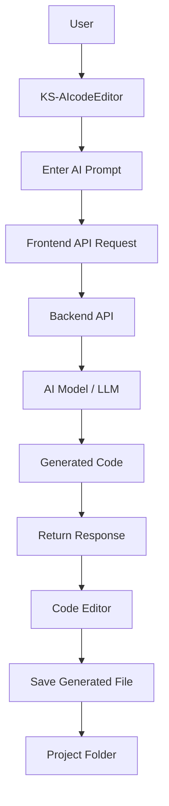
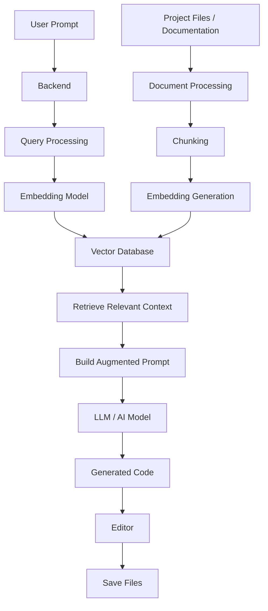
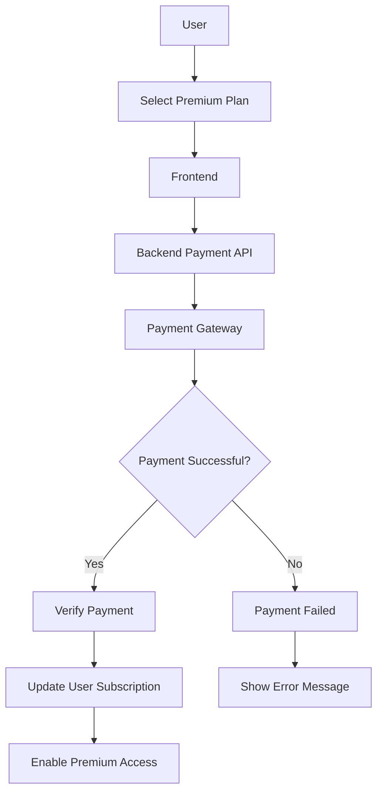

# KS-AIcodeEditor 🚀
### AI-Powered Code Editor — Code Smarter, Build Faster

KS-AIcodeEditor is an advanced, VS Code-inspired code editor integrated with AI capabilities. It combines a modern code-editing experience with intelligent code generation, allowing developers to describe what they want to build in natural language and generate code directly inside their development workspace.

Unlike a traditional code editor, KS-AIcodeEditor brings AI assistance into the coding workflow. Users can generate code using AI and automatically save the generated files into their selected project folders.

It also includes a payment system to support premium features and subscription-based access.

---

## ✨ Key Features

- **AI Code Generation:** Generate code by describing requirements in natural language.
- **VS Code-Inspired Editor:** A familiar coding experience with an integrated editor.
- **Automatic File Saving:** Save AI-generated code directly into the project folder.
- **Project-Based Development:** Organize generated code into files and folders.
- **AI Integration:** Connect an AI model to generate code and assist development.
- **RAG-Ready Architecture:** A retrieval workflow can provide relevant project context to the AI when implemented.
- **Payment Integration:** Support premium features through a payment gateway.
- **Backend Architecture:** Separate frontend and backend responsibilities for maintainability.
- **Developer Productivity:** Reduce repetitive coding and accelerate development.

---

## 🛠️ Tech Stack

| Category | Technologies |
|---|---|
| Frontend | React.js, JavaScript |
| Code Editor | Monaco Editor (if used in the current implementation) |
| Backend | Node.js, Express.js |
| Database | MongoDB |
| AI Integration | AI API / LLM provider |
| API Gateway | Express.js, express-http-proxy |
| Authentication | JWT (if enabled) |
| Payment | Integrated payment gateway |
| Development Tools | Git, GitHub, VS Code |
| Deployment | Docker / Cloud services (if configured) |

---

## 🧠 How KS-AIcodeEditor Works

The main idea is simple:

1. A user opens the code editor.
2. The user describes the code they want to generate.
3. The frontend sends the prompt to the backend.
4. The backend communicates with the configured AI model.
5. The AI generates the requested code.
6. The generated code is returned to the editor.
7. The application saves the generated code into the selected project folder.

### AI Code Generation Workflow



---

## 🔍 RAG Architecture

Retrieval-Augmented Generation (RAG) is a technique that provides an AI model with relevant external context before it generates a response.

For a code editor, a RAG workflow can retrieve relevant project files, code snippets, documentation, or previous context to help the AI generate code that fits the existing project.

### RAG Workflow Diagram



**Important:** This diagram describes a RAG architecture. Keep it as an implemented feature only if your application actually performs document processing, embedding generation, vector storage, and retrieval. Otherwise, treat it as a planned extension.

---

## 💳 Payment System Workflow

KS-AIcodeEditor includes a payment system for managing access to premium functionality.



Payment verification should happen on the backend before premium access is granted.

---

## 📁 Project Structure

The following is a suggested structure. Adjust it to match the actual folders in your repository.

```text
KS-AIcodeEditor/
│
├── frontend/
│   ├── src/
│   │   ├── components/
│   │   ├── pages/
│   │   ├── services/
│   │   └── ...
│   └── package.json
│
├── backend/
│   ├── services/
│   ├── config/
│   ├── routes/
│   ├── controllers/
│   └── package.json
│
├── .gitignore
└── README.md
```

---

## ⚙️ Installation & Setup

### 1. Clone the Repository

```bash
git clone https://github.com/keshviSolanki/KS-AIcodeEditor.git
```

### 2. Navigate to the Project

```bash
cd KS-AIcodeEditor
```

### 3. Install Dependencies

Install dependencies separately in the frontend and backend directories:

```bash
cd frontend
npm install
```

```bash
cd ../backend
npm install
```

### 4. Configure Environment Variables

Create `.env` files in the required frontend and backend directories.

Example configuration:

```env
# Backend
PORT=8000
MONGODB_URI=your_mongodb_connection_string
JWT_SECRET=your_jwt_secret
AI_API_KEY=your_ai_api_key

# Payment configuration
PAYMENT_KEY_ID=your_payment_key
PAYMENT_KEY_SECRET=your_payment_secret
```

Use the actual variable names required by your source code. Never commit real API keys, passwords, database credentials, or payment secrets.

### 5. Start the Application

Start the backend:

```bash
cd backend
npm run dev
```

Start the frontend in another terminal:

```bash
cd frontend
npm run dev
```

Check the individual `package.json` scripts if your project uses different commands.

---

## 🔐 Security

- Keep API keys and credentials in environment variables.
- Never expose payment secrets in frontend code.
- Verify payment transactions on the backend.
- Validate user input and API requests.
- Protect authenticated routes.
- Never commit `.env` files or private service-account credentials.

---

## 🚀 Future Improvements

- AI-powered debugging and error explanations.
- Multi-file code generation.
- Project-wide code understanding.
- RAG-based codebase retrieval.
- AI-powered code refactoring.
- Git integration inside the editor.
- Multiple AI model support.
- Real-time collaborative coding.
- Advanced code completion.

---

## 👨‍💻 Author

**Keshvi Solanki**

B.E. Information Technology Student | Full-Stack Developer | AI Application Developer

- GitHub: [@keshviSolanki](https://github.com/keshviSolanki)
- Project: [KS-AIcodeEditor](https://github.com/keshviSolanki/KS-AIcodeEditor)

---

## ⭐ Support

If you find KS-AIcodeEditor interesting, consider giving the repository a star on GitHub!

**Build faster. Code smarter. Create with AI.**
